# 🎯 QuizGame – Kvíz játék

**MFW beadandó** · Kiss István (T73N0W) · 2025/26 tavaszi félév

REST architektúrájú webalkalmazás online kvízek létrehozására, kezelésére és valós idejű lebonyolítására.

---

## 📑 Tartalomjegyzék

1. [Feladatleírás](#1-feladatleírás)
2. [Funkcionális elemzés](#2-funkcionális-elemzés)
3. [Rendszerarchitektúra](#3-rendszerarchitektúra)
4. [Statikus terv](#4-statikus-terv)
5. [Adatbázis terv](#5-adatbázis-terv)
6. [Szolgáltatás réteg](#6-szolgáltatás-réteg)
7. [Webszolgáltatás réteg](#7-webszolgáltatás-réteg)
8. [SignalR kommunikáció](#8-signalr-kommunikáció)
9. [Frontend felépítése](#9-frontend-felépítése)
10. [Tesztelés](#10-tesztelés)
11. [Képernyőképek és demó](#11-képernyőképek-és-demó)

---

## 1. Feladatleírás

A projekt célja egy REST architektúrájú webalkalmazás elkészítése volt, amely lehetőséget biztosít online kvízek létrehozására, kezelésére és valós idejű lebonyolítására.

Az alkalmazás két fő felületből áll:

- **Adminisztrációs felület:** a bejelentkezett felhasználók saját kvízeket hozhatnak létre, módosíthatnak, valamint vezérelhetik azok lebonyolítását.
- **Résztvevői felület:** a felhasználók PIN kód segítségével csatlakozhatnak aktív kvízekhez, és valós időben válaszolhatnak a kérdésekre.

---

## 2. Funkcionális elemzés

### 2.1 Felhasználói szerepkörök

| Szerepkör | Lehetőségek |
|---|---|
| **Adminisztrátor** (kvíz tulajdonos) | regisztráció, bejelentkezés, saját kvízek létrehozása / megtekintése / szerkesztése / törlése, kvíz megnyitása és indítása, léptetés a kérdések között, aktuális kérdés lezárása, aktív kvíz befejezése |
| **Résztvevő** | csatlakozás PIN kóddal, aktuális kérdés megtekintése, válasz beküldése, eredmény megtekintése |

### 2.2 Fő funkcionalitások

#### Felhasználókezelés

- regisztráció
- bejelentkezés
- JWT alapú autentikáció
- refresh token alapú token megújítás
- kijelentkezés

#### Kvízkezelés

A bejelentkezett felhasználók:

- új kvízt hozhatnak létre,
- megtekinthetik saját kvízeiket,
- törölhetik vagy módosíthatják a még el nem indított kvízeket.

Egy kvíz:

- legalább egy kérdést tartalmaz,
- minden kérdés legalább két válaszlehetőséget tartalmaz,
- minden kérdéshez pontosan egy helyes válasz tartozik.

#### Kvíz lebonyolítás (session kezelés)

A rendszer a kvízek futtatását külön sessionökkel kezeli. A session állapotai: `Waiting`, `InProgress`, `Finished`.

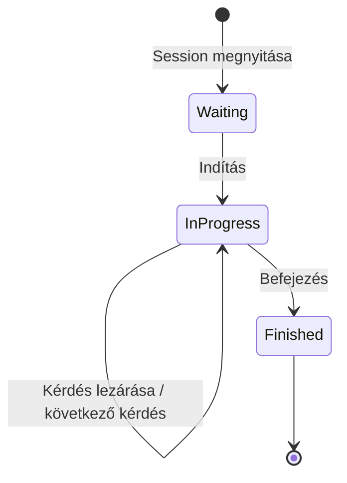

Az adminisztrátor:

- elindíthatja a sessiont,
- lezárhatja az aktuális kérdést,
- következő kérdésre léphet,
- befejezheti a sessiont.

#### Valós idejű kommunikáció

A SignalR segítségével:

- a résztvevők automatikusan megkapják az aktuális kérdést,
- az állapotváltozások azonnal megjelennek,
- nincs szükség az oldal újratöltésére.

---

## 3. Rendszerarchitektúra

### 3.1 Technológiák

| Terület | Technológiák |
|---|---|
| **Backend** | ASP.NET Core Web API, Entity Framework Core, ASP.NET Identity, JWT Authentication, SignalR, AutoMapper |
| **Frontend** | React, React Router, Bootstrap |
| **Adatbázis** | Microsoft SQL Server |
| **Tesztelés** | xUnit, ASP.NET Core Integration Testing |

---

## 4. Statikus terv

### 4.1 Réteges architektúra

A rendszer többrétegű architektúrát használ.

**Fő komponensek:**

- Frontend kliens alkalmazás
- WebAPI réteg
- Szolgáltatás réteg
- Adatkezelési réteg
- SQL adatbázis
- SignalR kommunikációs réteg

**A projekt fizikai felépítése:**

```text
QuizGame
├── QuizGame.DataAccess
├── QuizGame.Shared
├── QuizGame.SignalR
├── QuizGame.WebAPI
└── QuizGame.React
```

### 4.2 UML komponens diagram

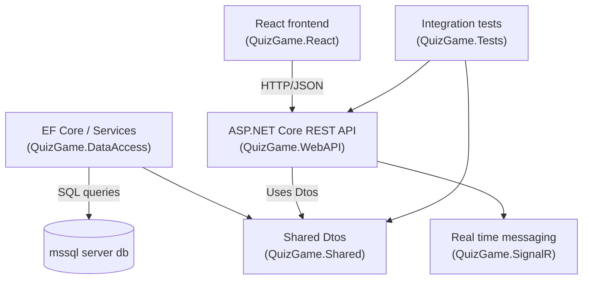

---

## 5. Adatbázis terv

### 5.1 Adatbázis leírás

Az alkalmazás relációs adatbázist használ Entity Framework Core ORM segítségével. Az alábbi ábra az adatbázis sémáját mutatja.

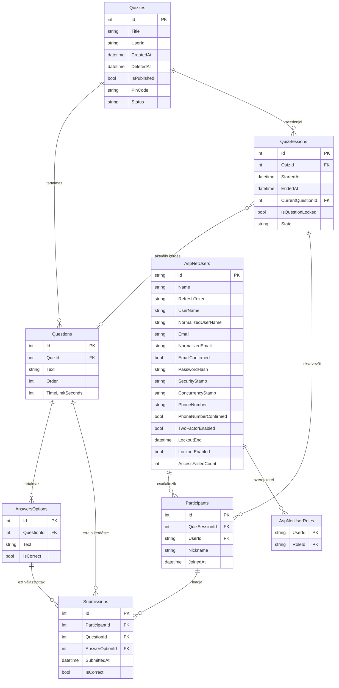

### 5.2 Kapcsolatok

| Kapcsolat | Leírás |
|---|---|
| Quiz – Question | Egy kvíz több kérdést tartalmaz. Egy kérdés pontosan egy kvízhez tartozik. |
| Question – AnswerOption | Egy kérdés több válaszlehetőséget tartalmaz. |
| Quiz – QuizSession | Egy kvízhez több session tartozhat. |
| QuizSession – Participant | Egy sessionhöz több résztvevő tartozhat. |
| Participant – Submission | Egy résztvevő több választ adhat le. |
| AnswerOption – Submission | Egy válaszlehetőséghez több leadott beküldés is tartozhat. |

---

## 6. Szolgáltatás réteg

A szolgáltatás rétegben találhatók a közvetlen adatbázis-műveletek. A réteg a `QuizGame.DataAccess` projektben valósult meg.

### Szolgáltatások osztálydiagramokban

#### Kvíz szolgáltatás

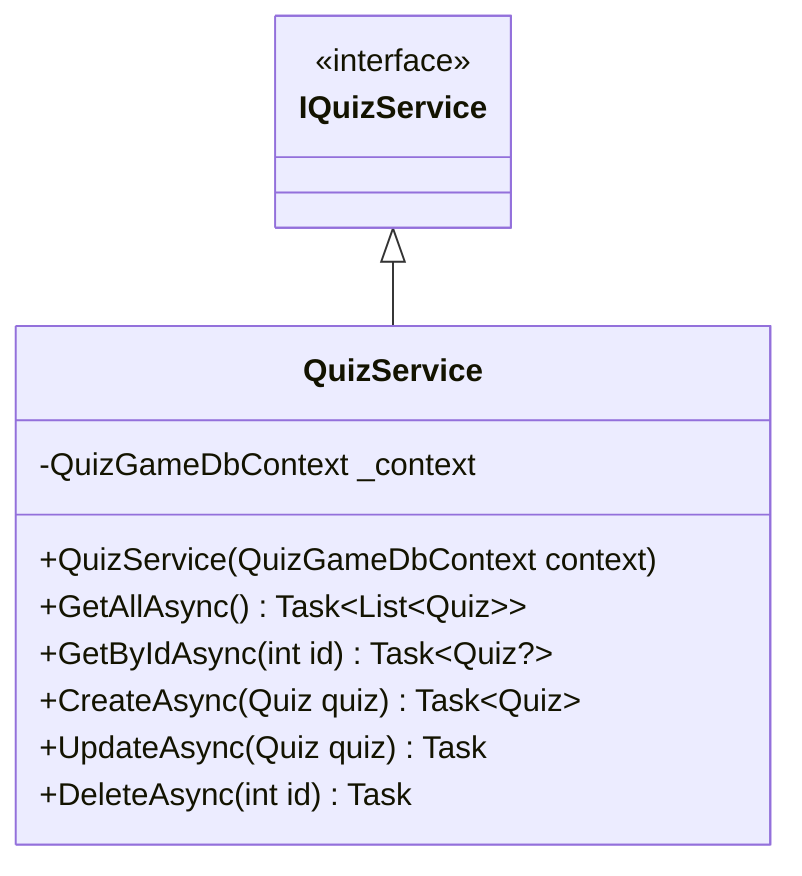

#### Kérdés szolgáltatás

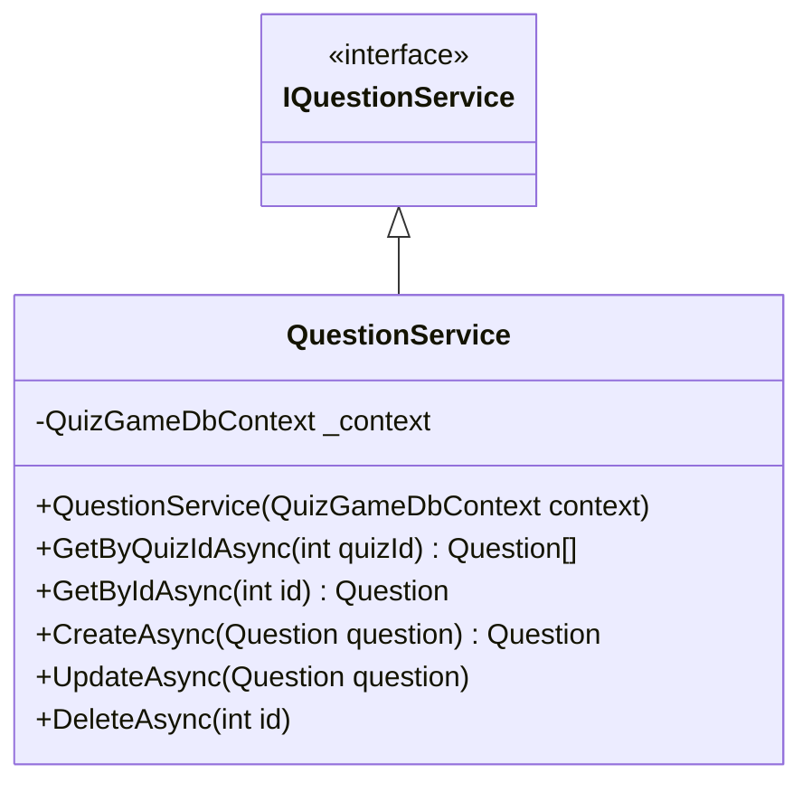

#### Kvíz session szolgáltatás

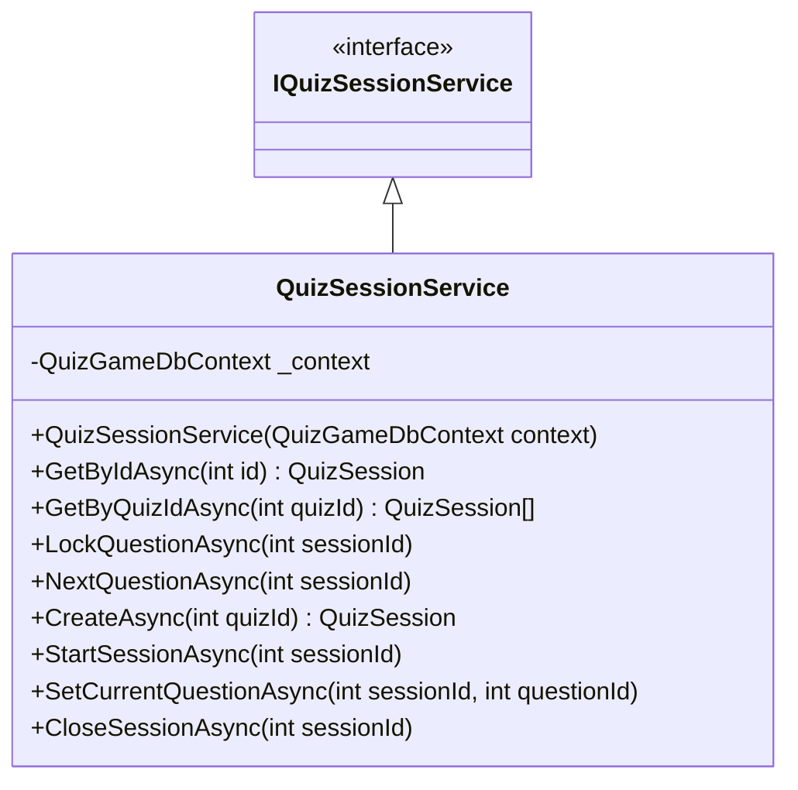

#### Felhasználó szolgáltatás

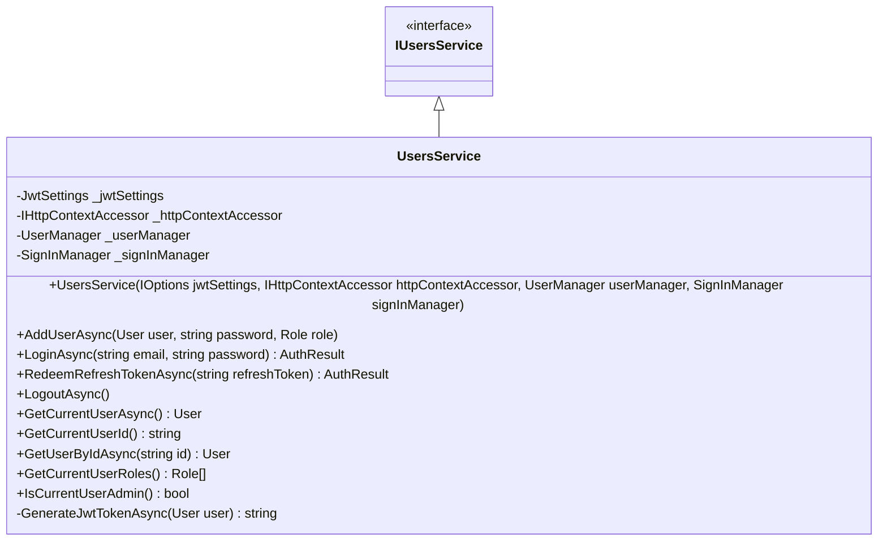

#### Résztvevő szolgáltatás

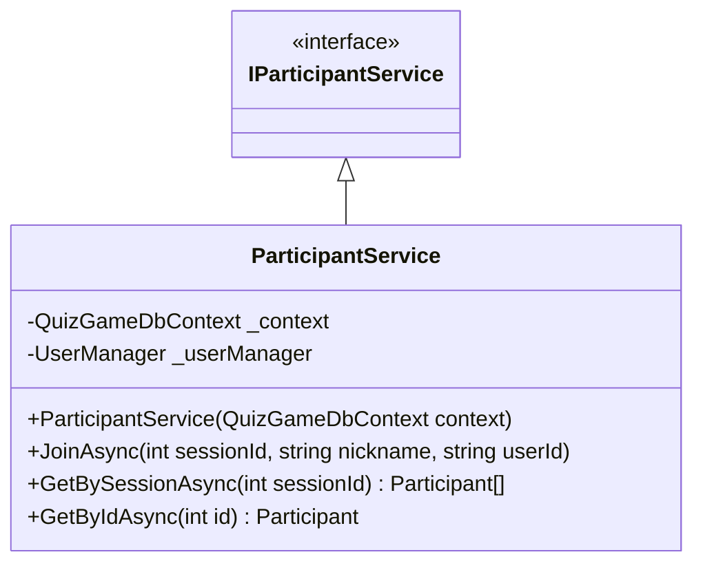

#### Leadás szolgáltatás

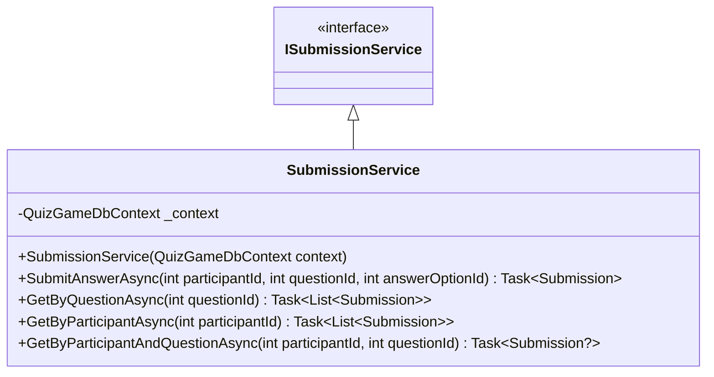

---

## 7. Webszolgáltatás réteg

### 7.1 QuizController

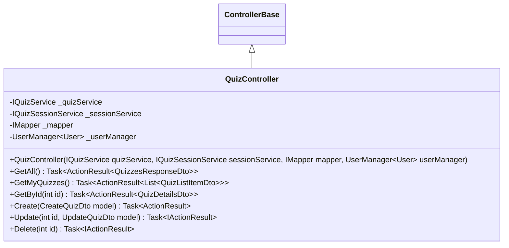

**Feladata:** kvízek kezelése, lekérdezése, létrehozása, módosítása, törlése.

| Metódus | Végpont | Leírás |
|---|---|---|
| GET | `/api/quiz` | Összes kvíz lekérdezése |
| GET | `/api/quiz/{id}` | Kvíz lekérdezése azonosító alapján |
| POST | `/api/quiz` | Kvíz létrehozása |
| PUT | `/api/quiz/{id}` | Kvíz módosítása |
| DELETE | `/api/quiz/{id}` | Kvíz törlése |

### 7.2 UsersController

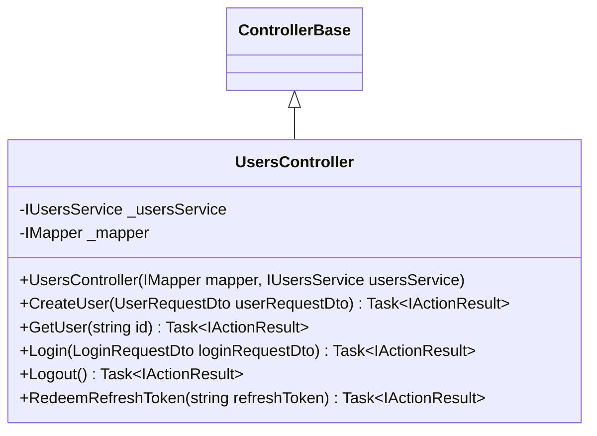

**Feladata:** felhasználókezelés, autentikáció, token kezelés.

| Metódus | Végpont | Leírás |
|---|---|---|
| POST | `/api/user/register` | Regisztráció |
| POST | `/api/user/login` | Bejelentkezés |
| POST | `/api/user/logout` | Kijelentkezés |
| POST | `/api/user/refresh` | Token megújítása |
| GET | `/api/user/{id}` | Felhasználó lekérdezése |

### 7.3 SessionController

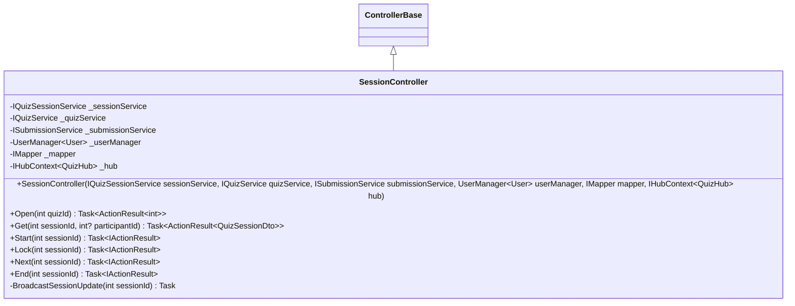

**Feladata:** sessionök kezelése, a kvíz lebonyolításának vezérlése.

| Metódus | Végpont | Leírás |
|---|---|---|
| POST | `/api/session/open/{quizId}` | Session megnyitása |
| POST | `/api/session/{sessionId}/start` | Session indítása |
| POST | `/api/session/{sessionId}/lock` | Aktuális kérdés lezárása |
| POST | `/api/session/{sessionId}/next` | Következő kérdés |
| POST | `/api/session/{sessionId}/end` | Session befejezése |
| GET | `/api/session/{sessionId}` | Session állapotának lekérdezése |

### 7.4 PlayerController

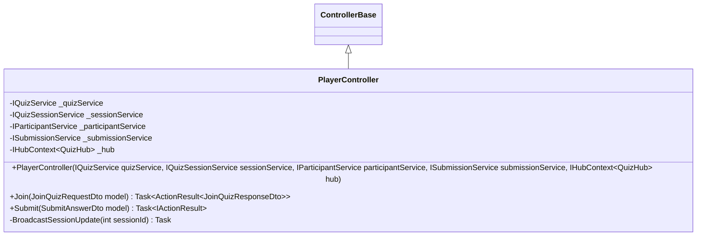

**Feladata:** résztvevők csatlakozása, válaszok beküldése.

| Metódus | Végpont | Leírás |
|---|---|---|
| POST | `/api/player/join` | Csatlakozás PIN kóddal |
| POST | `/api/player/submit` | Válasz beküldése |

---

## 8. SignalR kommunikáció

### 8.1 QuizHub

A rendszer SignalR Hub segítségével biztosítja a valós idejű kommunikációt. A kliensek session csoportokhoz csatlakoznak.

Az alábbi állapotváltozások automatikusan továbbításra kerülnek minden résztvevő számára:

- kérdés aktiválása
- kérdés lezárása
- következő kérdés
- session befejezése

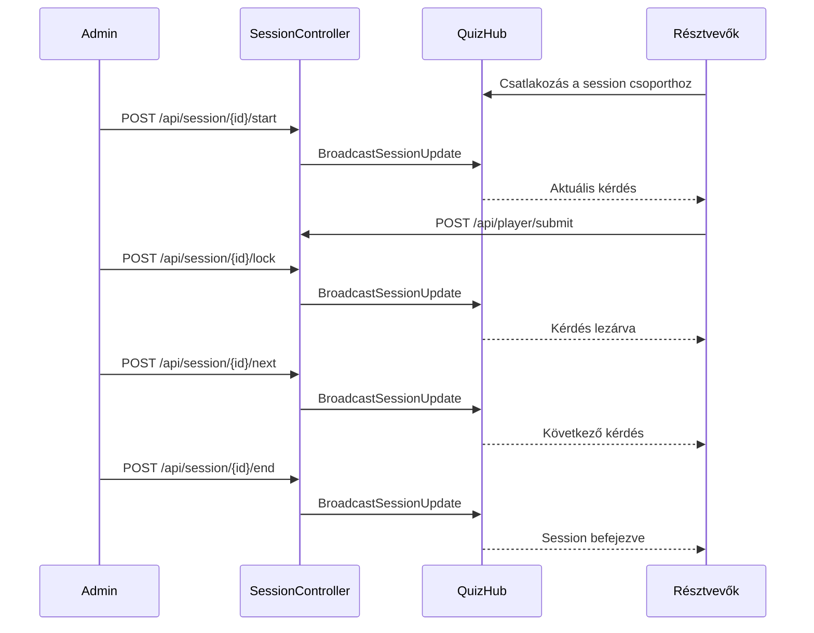

---

## 9. Frontend felépítése

### 9.1 Adminisztrációs felület

Főbb oldalak:

- `Login`
- `Register`
- `MyQuizzes`
- `QuizDetails`
- `CreateQuiz`
- `EditQuiz`
- `Session` oldal

### 9.2 Résztvevői felület

Főbb funkciók:

- csatlakozás PIN kóddal
- aktuális kérdés megjelenítése
- válaszadás
- eredmények megtekintése

---

## 10. Tesztelés

### 10.1 Integrációs tesztek

A webszolgáltatás funkcionalitásának ellenőrzése integrációs tesztekkel történt (xUnit + ASP.NET Core Integration Testing).

### 10.2 Tesztelt komponensek

#### QuizController tesztek

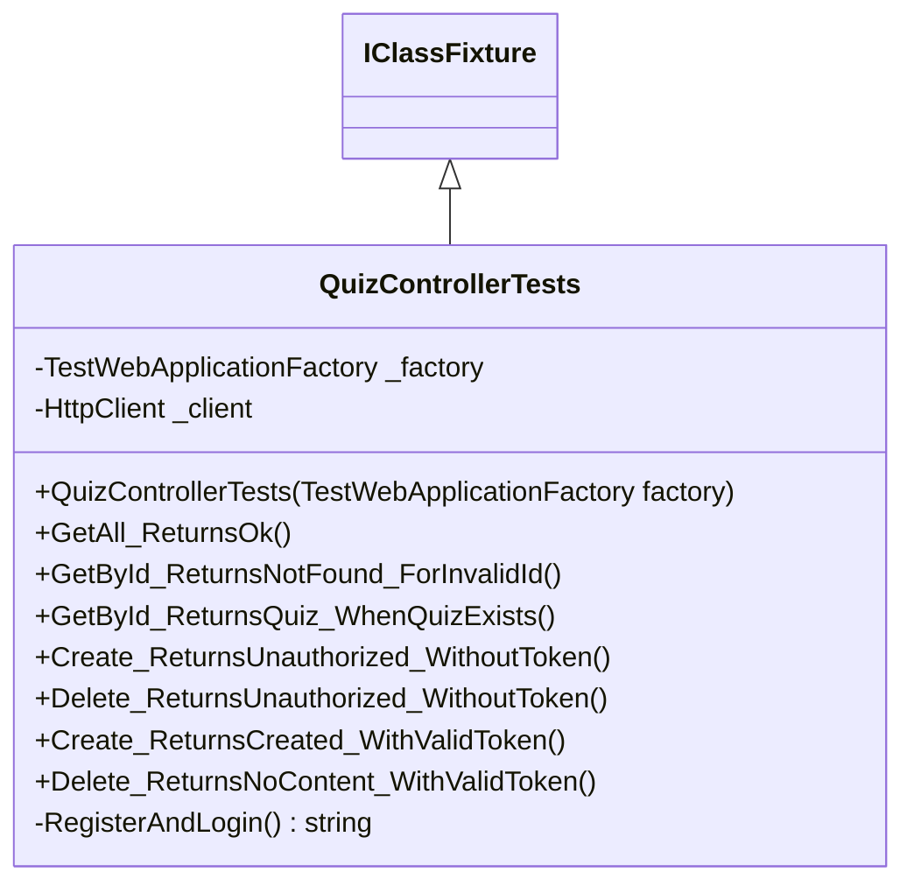

Tesztelt esetek:

- összes kvíz lekérdezése
- kvíz lekérdezése azonosító alapján
- nem létező kvíz kezelése
- kvíz létrehozása
- kvíz létrehozása autorizáció nélkül
- jogosultság ellenőrzése
- kvíz törlése

#### UsersController tesztek

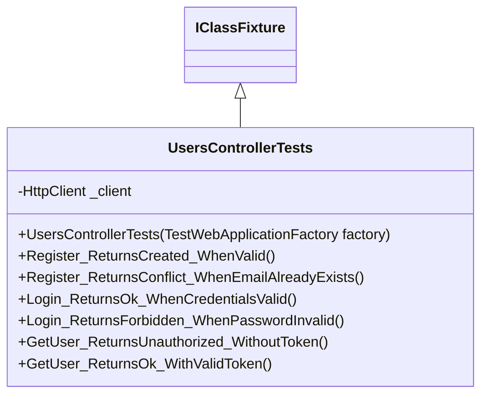

Tesztelt esetek:

- regisztráció
- bejelentkezés
- hibás bejelentkezés
- felhasználó lekérdezése
- jogosultság kezelés

#### SessionController tesztek

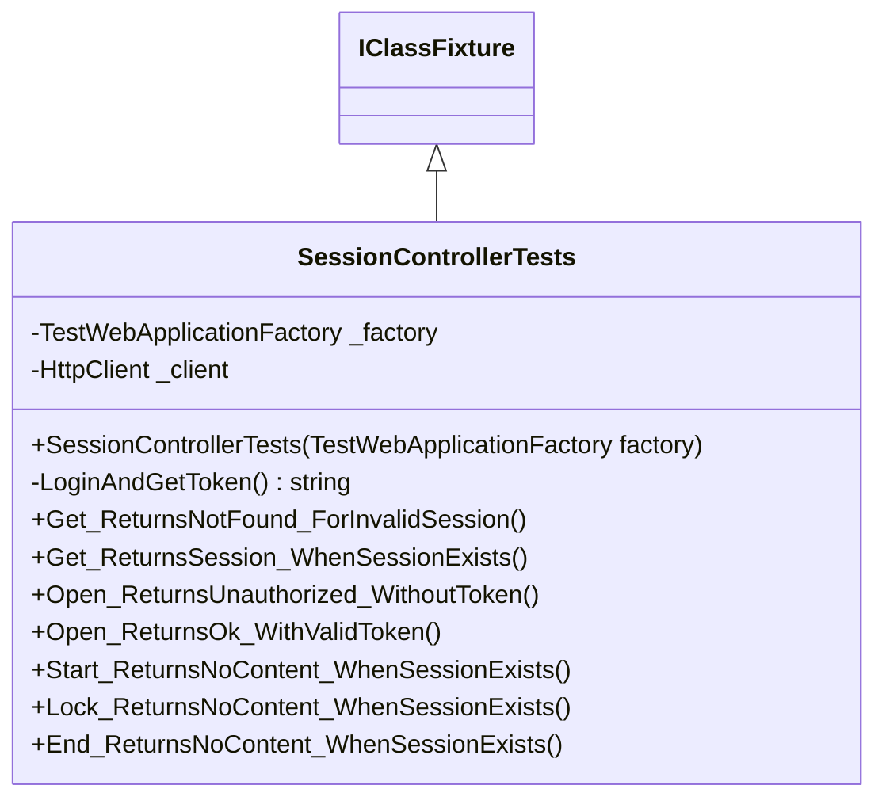

Tesztelt esetek:

- session megnyitása
- session megnyitása nem létező session esetén
- session indítása autentikáció nélkül
- session indítása
- kérdés lezárása
- session befejezése
- session állapot lekérdezése

#### PlayerController tesztek

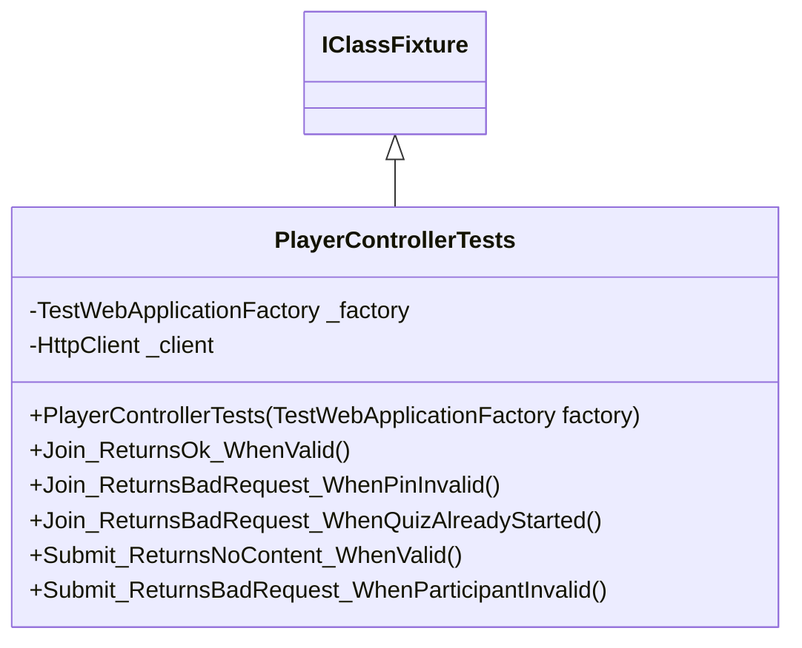

Tesztelt esetek:

- csatlakozás PIN kóddal
- hibás PIN kezelés
- csatlakozás elkezdett sessionhöz
- válasz beküldése
- helytelen résztvevőként válaszolás

---

## 11. Képernyőképek és demó

### 📋 TODO
